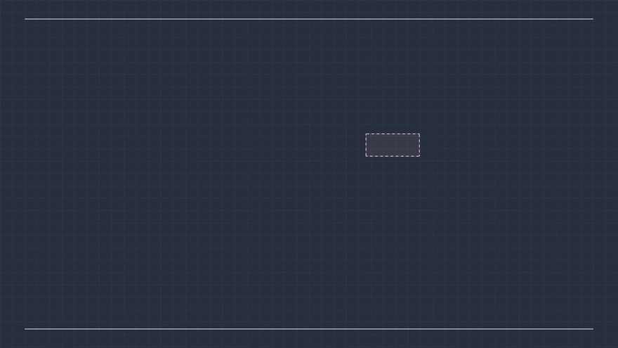

<b>Region capture for Windows that works on any display setup.</b> 
One portable 168 KB exe · MIT licensed

DisplayShot is based on **ScreenShot**, the region-capture tool that shipped with IObit Advanced
SystemCare. It keeps that tool's fast workflow (the screen freezes, you pick a window or drag an area,
mark it up, copy or save) and rebuilds it from scratch so it works on every monitor, at every
resolution, scaling and orientation, always in real pixels.

   
  The first 44 seconds of the film · <a href="docs/media/displayshot.mp4">full film with sound (1:29, MP4)</a>

---

## What it does

Launch `DisplayShot.exe`, or press **Ctrl+Alt+X** when it runs in the background (see below). The
screen freezes and dims:

* **Hover** a window to highlight it; **click** (or press **Enter**) to select it, or **drag** to
  select any area. The magnifier shows the size and the colour under the cursor.
* **Move** the selection by dragging inside it or with the arrow keys (Shift for 10 px steps);
  **resize** it with the eight small handles. The handles and arrow keys keep working while you
  draw, and your marks stay exactly where you put them.
* **Annotate** with rectangle, oval, straight line, arrow (hold Shift for 45° steps), brush and
  text, in 16 colours and three pen sizes. **Pixelate** hides passwords, names or faces, in three
  block sizes. **Undo** with Ctrl+Z, **redo** with Ctrl+Y.
* **Copy** to the clipboard.
* **Save** (the floppy button) writes a PNG straight into your save folder, no dialog.
  To change that folder, click the small folder badge on its corner, or right-click Save.
  Until you choose one it's `Pictures\Screenshots`, the same folder Windows uses for Win+PrtScn.
* **Save as** (the folder button) opens the usual dialog to choose any folder and format (PNG,
  JPEG, BMP, GIF, TIFF). The folder you pick there also becomes Save's folder.
* **Gear button**: choose which toolbar buttons to show; the toolbar shrinks to fit and remembers
  your choice. Keyboard shortcuts keep working for hidden buttons. **Also copy when saving** makes
  Save and Save as put the image on the clipboard too, so one key both files and copies it.
* **Right-click** goes back to window selection (or exits when nothing is selected); **Esc** exits.

The toolbar, magnifier and handles follow the scaling of the monitor they are on, so they look the
same size on a 150 % laptop screen and on a 100 % monitor next to it.

### Keyboard

| Keys | Action |
|---|---|
| Enter | Select the hovered window; with a selection, Save |
| Ctrl+S | Save to the save folder |
| Ctrl+Shift+S | Save as… |
| Ctrl+C | Copy |
| Ctrl+Z / Ctrl+Y | Undo / redo |
| Arrow keys, Shift+arrows | Move the selection 1 px / 10 px |
| Esc | Exit |

### Background mode

In the gear menu, tick **Run in the background (Ctrl+Alt+X)**. DisplayShot then stays in the
notification area and opens a capture instantly with **Ctrl+Alt+X** (Win+Shift+S stays free for the
Windows tool) or with a click on its tray icon. Launching `DisplayShot.exe` while it runs also hands
the capture to it. **Start with Windows** (gear or tray menu) starts it at sign-in; untick it, or
choose **Exit** in the tray menu, to stop.

### Settings

`DisplayShot.ini`, next to the exe, remembers the save folder, "Also copy when saving", the hidden
toolbar buttons and two "don't show again" choices. The only thing stored elsewhere is **Start with
Windows**: a value named `DisplayShot` under `HKCU\Software\Microsoft\Windows\CurrentVersion\Run`.
Nothing is installed; to remove DisplayShot, untick Start with Windows and delete its folder.

### Get it

DisplayShot needs Windows 10 or 11 (the .NET Framework 4 it uses is part of Windows).

* **Download** `DisplayShot.exe` from the [Releases](../../releases) page and run it, or
* **build** it: run `build.cmd`. It uses the C# compiler that ships with Windows, embeds the images
  from `assets\` and writes `bin\DisplayShot.exe`. No SDK or Visual Studio needed.

---

## DisplayShot and the original ScreenShot

| | ScreenShot 7.0 (IObit) | DisplayShot |
|---|---|---|
| Mixed monitors (different resolutions, scaling, portrait) | Selections stop at the primary monitor's height; window detection and panels misplace on other monitors | Works on every monitor, in physical pixels |
| Drawing tools | Rectangle, oval, brush, text | Adds straight line, arrow and pixelate; redo |
| Saving | A dialog every time | One key to a default folder, or Save as; optional copy on save |
| Always ready | Launch the exe each time | Optional background mode with Ctrl+Alt+X |
| Files | 7: the exe and 6 Delphi runtime packages | 1 exe |
| Size | 5.4 MB | 168 KB, artwork included |
| Built with | Delphi 2009 | C# 5, Windows Forms on .NET Framework 4 |
| Source | Closed | MIT |

---

## Where it comes from

There is a hot new breakthrough in the Generative AI space: agents can now mess with closed-source applications, port them, and even reverse-engineer them. After finding out about this, I instantly knew where to test it.

For years I used ScreenShot 7.0 from IObit Advanced SystemCare. When I moved to a mixed setup (a
1920×1080 monitor at 125 %, a 2560×1440 main monitor at 125 % and a 1080×1920 portrait monitor at
100 %), it broke in three ways: Windows ran it through a scaling shim that distorted its coordinates,
selections couldn't go below the primary monitor's height, and its panels landed off-screen.

Working with [Claude Code](https://claude.com/claude-code), I first patched the 2009 binary: one
registry flag for the scaling, then 12 calls in the machine code redirected to a small helper that
asks Windows for the right monitor. It worked, but every further change would have meant more
hand-written machine code. So the app's behaviour was written down as specifications and rebuilt in
C#. DisplayShot is that rebuild, with its own name, icon and artwork. The faithful port and the notes
about the original's internals contain IObit material, so they stay private.

The look follows my personal site's [juancr.uz](https://www.juancr.uz/) style: charcoal-blue backgrounds,
lavender glyphs, vintage grape for the active tool, Palatino Linotype for the logo and Segoe UI for
the interface. Every image (logo, icon, toolbar glyphs) is drawn by `tools/make_assets.py`. The
fonts are only used to render the images and on screen; they aren't distributed with this project.

---

## Under the hood

### How a capture works

1. The process is per-monitor DPI aware (`src\app.manifest`), so every coordinate is a physical
   pixel on every monitor.
2. Before any window appears, DisplayShot lists the visible windows and their child windows for
   hover detection (skipping hidden and fully covered ones) and copies the whole virtual desktop into
   one bitmap. That's why the overlay never shows up in a capture.
3. One borderless, topmost window covers all monitors. It draws a dimmed copy of the screenshot and
   the selected area at full brightness, with GDI.
4. Annotations are drawn into the selection's bitmap. Undo and redo restore the clean selection and
   replay the list of shapes.
5. The toolbar, sub-panel, magnifier and handles read the DPI of the monitor they are on and scale
   to it; the glyphs are 128 px images resampled to size.
6. In background mode a hidden window owns the Ctrl+Alt+X hotkey and the tray icon. A second launch
   finds it by its window title and posts it a message instead of starting its own capture.

### Testing

Every change was checked by scripts that drive the real app with the mouse and keyboard and compare
pixels: region captures on each monitor and across two monitors had to match the screen exactly, a
forced repaint had to change zero pixels, and moving, resizing, saving, the clipboard and background
mode were exercised end to end. The scripts were written for one specific monitor layout, so they
aren't part of this repository.

### Code map

| Path | Contents |
|---|---|
| `src\Program.cs` | Start-up: single instance, window list, screen capture |
| `src\Background.cs`, `src\TrayToast.cs` | Background mode: tray icon, Ctrl+Alt+X, Start with Windows |
| `src\OverlayForm*.cs` | The capture overlay: hover and selection, toolbar and output, drawing tools |
| `src\WindowList.cs` | Window auto-detection |
| `src\AnnotationTextBox.cs` | Text tool editor |
| `src\CopiedForm.cs`, `src\HintForm.cs` | "Copied to the clipboard" message, first-run hint |
| `src\Theme.cs` | Palette and fonts |
| `src\SaveButton.cs`, `src\FolderPicker.cs` | Save button with its folder badge, folder chooser |
| `src\ImageButton.cs`, `SizePicker.cs`, `GdiSurface.cs`, `Native.cs`, … | Controls and support code |
| `tools\make_assets.py` | Generates the logo, icon and glyphs (`python tools\make_assets.py`, needs Pillow) |

---

## Credits

DisplayShot is based on ScreenShot, the capture tool included with IObit Advanced SystemCare. It was
written from scratch in C#: it contains no IObit code or artwork and is not affiliated with or
endorsed by IObit. Colours and fonts follow [changazo/page](https://github.com/changazo/page). Built
with [Claude Code](https://claude.com/claude-code).

## License

[MIT](LICENSE) © 2026 Juan Cruz Changazo
